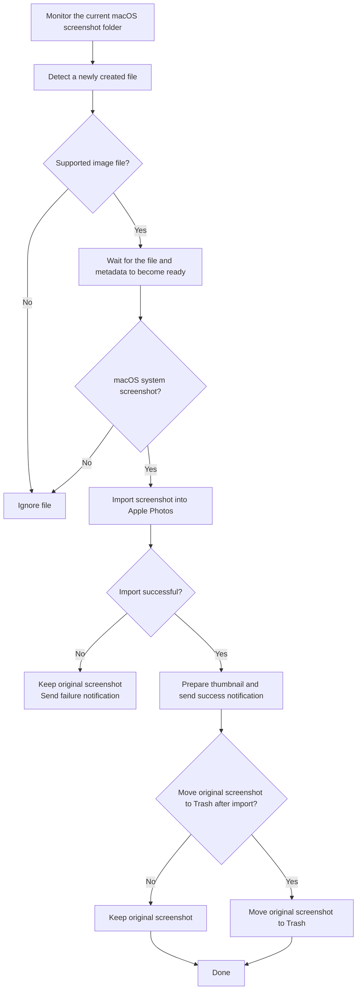

  

<h1 align="center">Shot2Photos</h1>

Automatically import macOS screenshots into Apple Photos.

  
  

Shot2Photos is a lightweight native macOS utility that imports system screenshots taken with `⌘⇧3`, `⌘⇧4`, and `⌘⇧5` into Apple Photos. It is particularly useful if you have iCloud Photos enabled.

## System Requirements

- macOS 15.0 or later
- A Mac with Apple silicon or Intel processor
- Apple Photos with an available Photos Library
- macOS screenshots captured with `⌘⇧3`, `⌘⇧4`, or `⌘⇧5`

Shot2Photos is distributed as a universal macOS app for Apple silicon and Intel Macs.

## Installation

1. Download the latest release from [Releases](https://github.com/dennis6481/shot2photos/releases/latest).
2. Open the downloaded archive or disk image.
3. Drag `Shot2Photos.app` into the `/Applications` folder.
4. Launch Shot2Photos.
5. Open the app's **Settings** from the menu bar item and confirm that the filesystem monitor is running.
6. Grant Photos access when macOS asks for it, or use **Request Photos Access** in Settings.
7. Take a screenshot using `⌘⇧3`, `⌘⇧4`, or `⌘⇧5`.

Shot2Photos runs as a menu bar app and monitors the screenshot location configured in macOS. If no custom location is configured, it monitors the Desktop.

## Permissions

### Photos Access

Photos access is required for Shot2Photos to add screenshots to your Photos Library.

If access is denied, screenshots are not imported and the original files are preserved. You can grant access from **System Settings → Privacy & Security → Photos**.

### Notifications

Notification access is optional.

If notifications are disabled, screenshots can still be imported into Photos. You simply will not receive success or failure notifications.

### Screenshot Folder Access

Shot2Photos monitors the screenshot location currently configured in macOS.

Depending on that location and your macOS privacy settings, you may need to allow Shot2Photos to access the folder. For example, if screenshots are saved to the Desktop, macOS may request access to the Desktop folder.

### Launch at Login

Launch-at-login is optional.

If enabled, macOS may require approval in **System Settings → General → Login Items**.

## Features

- **Automatic screenshot folder detection**  
  Monitors the screenshot location currently configured in macOS. If no custom location is configured, the Desktop is used.

- **System screenshot detection**  
  Newly created images are checked using macOS screenshot metadata, such as `kMDItemIsScreenCapture`. Regular images copied, downloaded, or moved into the same folder are ignored.

- **Automatic Photos import**  
  Confirmed screenshots are automatically imported into the Apple Photos library using PhotoKit.

- **Native notifications with thumbnails**  
  After a successful import, the app sends a native macOS notification containing a thumbnail of the screenshot.

- **Optional source file cleanup**  
  Users can choose whether to keep the original screenshot or automatically move it to the macOS Trash after a successful Photos import. Files are never permanently deleted.

- **Safe failure handling**  
  The original screenshot is always preserved if the Photos import fails. A failure notification may be shown.

- **Duplicate event protection**  
  Filesystem events may be emitted multiple times for the same file. The app prevents a screenshot from being imported more than once during processing.

## License

Shot2Photos is licensed under the GNU General Public License v3.0 or later.

See [LICENSE](LICENSE).

Copyright (C) 2026 Rui Ma